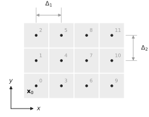
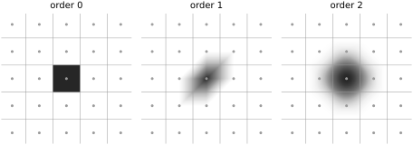
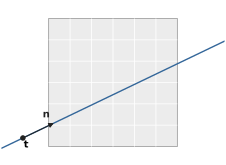
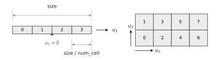
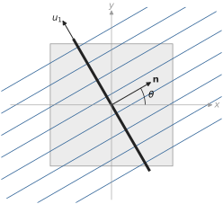
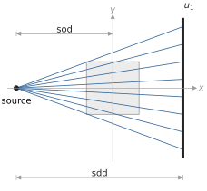
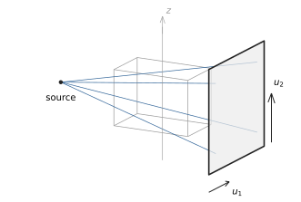

Geometry
========

Conventions shared by all operators, and the standard scans.

Volume
------

   A 2D lattice with ``num = (4, 3)``: knots (dots), and the index of each coefficient in the flat
   array (grey).

:py:class:`~xrt_toolkit.UniformSpec` defines the knots :math:`\bbx_{\bbq} = \bbx_{0} + \bbq \odot \bbDelta`, with ``start`` :math:`= \bbx_{0}`, ``step`` :math:`= \bbDelta` and ``num`` :math:`= \bbQ`.
At order 0, each knot is the centre of its voxel.

A volume is the flat C-ordered array of its coefficients :math:`f_{\bbq}`, indexed :math:`(x, y[, z])`: the last axis is the fastest.
A NumPy array ``f`` of shape ``num`` is passed as ``f.ravel()``.

The standard scans rotate about the origin: center the lattice on it with :py:meth:`UniformSpec.centered() <xrt_toolkit.UniformSpec.centered>`.

Basis functions
---------------

   The 2D basis functions :math:`\psi` on the lattice.

``order`` selects :math:`\psi`: voxels (0), or smoother splines (1, 2).
In 2D they are box splines, in 3D tensor-product B-splines (see :py:func:`~xrt_toolkit.xrt_apply`).

Every :math:`\psi` has unit integral: :math:`f_{\bbq}` is the mass of :math:`f` around :math:`\bbx_{\bbq}`, and :math:`f_{\bbq} / (\Delta_{1} \cdots \Delta_{D})` its density.

Rays
----

   A ray: anchor :math:`\bbt` and direction :math:`\bbn`.

:py:func:`~xrt_toolkit.xrt_apply` integrates :math:`f` along the whole line :math:`\{\bbt + \alpha \bbn : \alpha \in \bR\}`, by arc length:

- the anchor can be anywhere on the line, inside or outside the volume;
- the direction can have any non-zero length.

Rays are passed as two (D, L) arrays, one column per ray:

.. code-block:: python

   import drjit as dr, numpy as np
   from drjit.cuda import Array2f, Float
   import xrt_toolkit as xtk

   t = Array2f(t_x, t_y)  # (2, L) anchors
   n = Array2f(n_x, n_y)  # (2, L) directions
   y = xtk.xrt_apply((t, n), knot_spec, order, Float(f.ravel()))

Detector
--------

   Left: a 1D detector with ``num_cell = 4``. Right: a 2D detector with ``num_cell = (4, 2)``, and
   the order of its cells in the projections.

:py:class:`~xrt_toolkit.util.DetectorSpec` gives the full ``size`` of the detector (not its pitch) and its ``num_cell``.
Cells are centred: cell :math:`i` of :math:`N` sits at :math:`u = (i - (N - 1) / 2) \, \text{size} / N`.
With an even ``num_cell``, :math:`u = 0` falls between two cells.

Parallel beam
-------------

   View :math:`\theta` of :py:func:`~xrt_toolkit.parallel_beam`.

View :math:`\theta` has rays along :math:`\bbn = (\cos\theta, \sin\theta[, 0])`.
Its detector passes through the origin, with :math:`u_{1}` along :math:`(-\sin\theta, \cos\theta[, 0])` and, in 3D, :math:`u_{2}` along :math:`z`, the rotation axis.
Angles cover :math:`[0, \pi)`: view :math:`\theta + \pi` sees the same lines as view :math:`\theta`.

.. code-block:: python

   knot_spec = xtk.UniformSpec.centered(step=1, num=(N, N, N))
   det = xtk.util.DetectorSpec(size=(1.5 * N, N), num_cell=(192, 128))
   angles = dr.linspace(Float, 0, np.pi, 180, endpoint=False)
   rays = xtk.parallel_beam(angles, det)
   y = xtk.xrt_struct_apply(rays, knot_spec, order, Float(f.ravel()))

Cone beam
---------

   View :math:`\theta = 0` of :py:func:`~xrt_toolkit.cone_beam`.

   The same view in 3D.

The source sits at :math:`-\text{sod} \, (\cos\theta, \sin\theta[, 0])`.
The detector faces it at distance ``sdd``, with :math:`u_{1}` and :math:`u_{2}` as in parallel beam.
It must cover the volume magnified by :math:`\text{sdd} / \text{sod}`.
Angles cover :math:`[0, 2\pi)`: views :math:`\theta` and :math:`\theta + \pi` see different lines.

.. code-block:: python

   det = xtk.util.DetectorSpec(size=(2.5 * N, 2.5 * N), num_cell=(256, 256))
   angles = dr.linspace(Float, 0, 2 * np.pi, 360, endpoint=False)
   rays = xtk.cone_beam(sod=2 * N, sdd=3 * N, angles=angles, detector_spec=det)

Projection layout
-----------------

The structured operators order their projections ``(view, u1[, u2])``, the last axis fastest: ``y`` reshapes to ``(len(angles), *num_cell)``.
:py:func:`~xrt_toolkit.struct_rays` returns the same rays, in the same order.

Units
-----

All lengths share one unit: ``knot_spec``, ``DetectorSpec.size``, ``sod``, ``sdd`` and the rays.
Work in voxel units (``step = 1``):

- coefficients and densities coincide;
- in float32, other units lose accuracy (up to a few % at ``step = 0.0025``).

For a scan in millimetres with voxel size :math:`s`, divide all lengths by :math:`s`.
